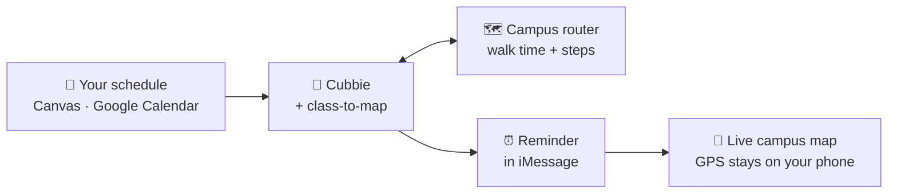

<div align="center">

# 🗺️ Class to Map

### Never be late to class again.

**Cubbie texts you when to leave, timed from your last class, with a live ASU campus map to get there.**


&nbsp;&nbsp;


### [🧭 Try the live map](https://nikman800.github.io/asu-map/?from=TTC&to=MU) &nbsp;·&nbsp; [🧊 See it in 3D](https://nikman800.github.io/asu-map/3d.html?from=ISTB4,SRC,tooker-house-a) &nbsp;·&nbsp; [📍 Route from where you are](https://nikman800.github.io/asu-map/?from=here&to=MU)

</div>

---

## ⚡ Install in one text

Text this link to your Cubbie and reply **yes**:

```text
https://github.com/owen0124/DevHacks_26
```

That's it. No API keys, no logins, no app to download.

## 💬 What it feels like

```text
You      I always lose track of time. Remind me when to leave for CHEM 101.

Cubbie   CHEM 101 in the MU at 10 am. You're in PSF until 9:15, about 7 min walk.
         I'll text you at 9:48 to go. OK?

You      yes

                              ⏰ 9:48 am

Cubbie   class-to-map: time to head to CHEM 101 (10:00 am, Memorial Union).
         About 7 min walk from PSF.
         Go now? Reply go, snooze 5, snooze 15, snooze 30, or skip
         https://nikman800.github.io/asu-map/?from=here&to=MU&fallback=physical-science-f-wing

You      go

Cubbie   Head southwest on the walkway (2 min)
         Continue south on Palm Walk (2 min)
         https://nikman800.github.io/asu-map/?from=here&to=MU&fallback=physical-science-f-wing
         (plus a Google Maps link for turn-by-turn)
         You've got this 🏃
```

<sub>An example conversation; the times, steps and link are what the Skill's campus router really produces for PSF → MU.</sub>

## ✨ Why it's different

| | What you get |
|---|---|
| 🧠 **Knows where you'll be** | Reads your schedule from Canvas or Google Calendar and times the reminder from the class you're in right before, not a guess from home. |
| 📍 **Routes from where you are** | Tap the link and the map plans the walk from your phone's live location, re-planning every 15 m as you go. Location off? It falls back to the building your schedule put you in. |
| 🏫 **Speaks ASU** | Understands what Canvas gives it, like `PSF 101`, `COOR 170` or `ECG G237`, and what students say, like *the MU*, *SDFC* or *TTC*. |
| 🚶 **Real campus paths** | Walks Palm Walk, Cady Mall and the rest across 297 buildings, not just the streets a car map knows. |
| 🧊 **A 3D campus** | Our team's 1:10,000 model of ASU Tempe, lined up with the real map to about 1.5 m, with your route drawn on it. |
| 😴 **Snooze, skip, Zoom** | Reply `go`, `snooze 15` or `skip`. Zoom classes get the Zoom link instead of directions. |
| 🔒 **Private by design** | Your location never leaves your phone. The map is a static page with no server and no tracking. |

## 🧊 The campus in 3D

<div align="center">


<sub>Three friends from ISTB4, the Sun Devil Fitness Complex and Tooker House: the map picks <b>Creativity Commons</b>, 5, 3 and 8 minutes away.</sub>
</div>

Give the map several starting points and it finds the **fairest place to meet**: the one where nobody walks much longer than anyone else. [Try it →](https://nikman800.github.io/asu-map/?from=ISTB4,SRC,tooker-house-a)

## 🧩 How it works



1. **Plan.** Cubbie finds the class and where you'll be beforehand, then runs the Skill's campus router to get the exact walking time.
2. **Remind.** It sets a reminder for *start time − walk − your buffer* and checks the plan with you first.
3. **Guide.** The reminder's link opens the live map, routed from wherever you actually are.

Off campus, or going by bike, bus or car? The Skill falls back to a normal Google or Apple Maps link.

## 📦 What's inside

```text
SKILL.md            what Cubbie should do, in plain words
scripts/route.mjs   the campus router's command line
scripts/route.js    the routing engine (no dependencies)
assets/campus.json  ASU Tempe walkways and buildings, from OpenStreetMap
```

Try the router yourself with Node:

```bash
node scripts/route.mjs route "PSF 101" MU --live
node scripts/route.mjs find "life sciences"
```

The map, the 3D view and the tools that build the data live in **[Nikman800/asu-map](https://github.com/Nikman800/asu-map)**.

## 🙌 Credits

- Built for the [Cubbie Hackathon](https://hackathon.cubbie.ai) at DevHacks 2026.
- 3D campus model by our team's mechanical engineer.
- Map data © [OpenStreetMap](https://www.openstreetmap.org/copyright) contributors, under the Open Database License.
- Map drawing by [Leaflet](https://leafletjs.com); 3D by [three.js](https://threejs.org).

<div align="center">

**Made with ☕ and a lot of walking across Hayden Lawn.**

</div>
